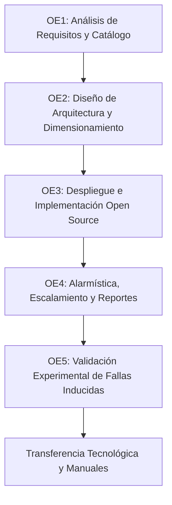
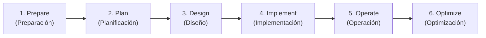
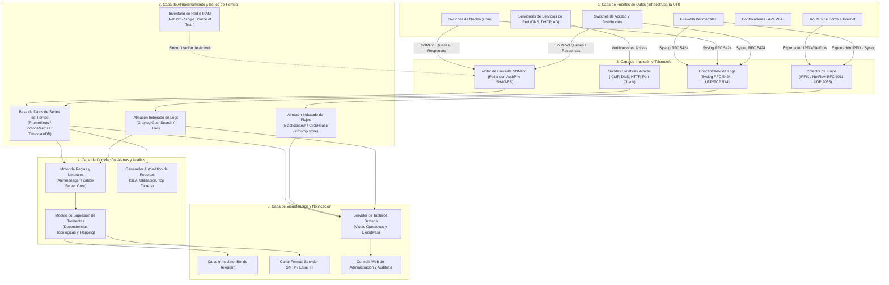
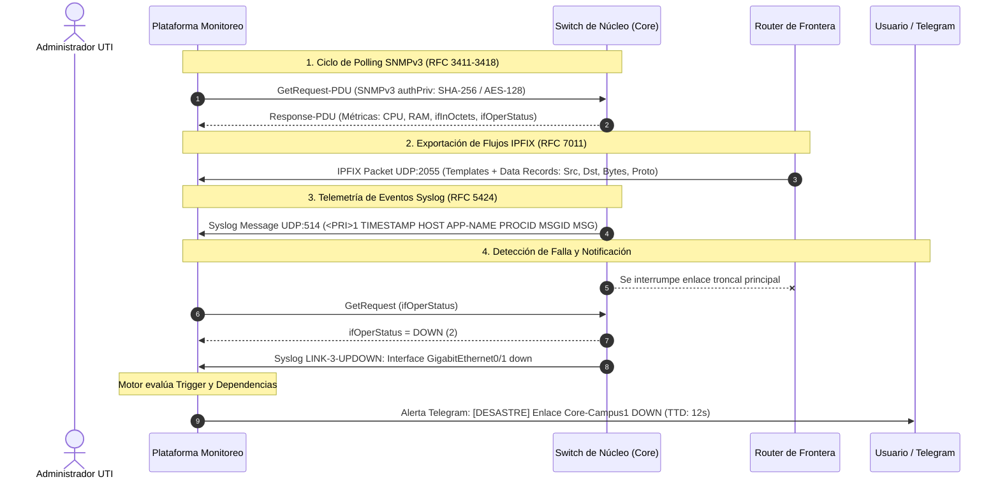
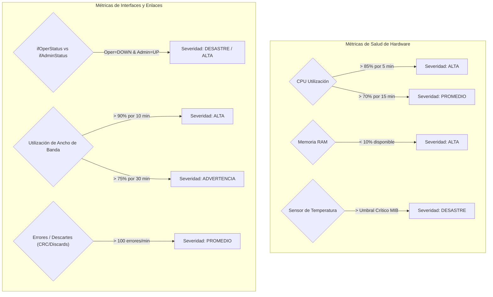
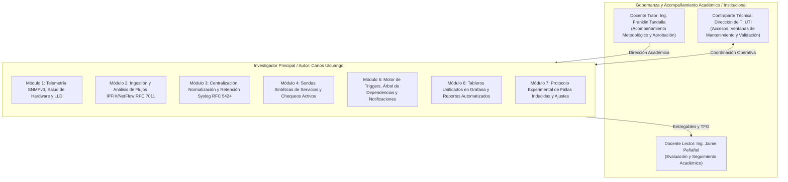
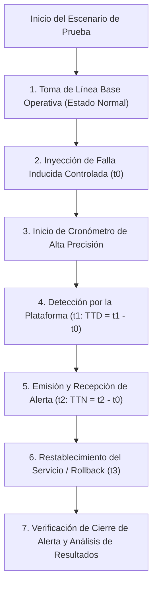

# ESPECIFICACIÓN TÉCNICA DE PROYECTO (PROJECT SPEC)
## Trabajo de Fin de Grado — Ingeniería en Tecnologías de la Información

---

| **Metadato** | **Detalle Institucional** |
| :--- | :--- |
| **Título del Proyecto** | **Diseño e implementación de una plataforma de monitoreo y observabilidad de la infraestructura y los servicios de red de la Universidad Tecnológica Indoamérica, basada en SNMPv3, análisis de flujos IPFIX y centralización de registros.** |
| **Código Institucional** | `ITI-TFG-B26-0023` |
| **Institución / Facultad** | Universidad Tecnológica Indoamérica · Facultad de Ingenierías |
| **Carrera / Modalidad** | Ingeniería en Tecnologías de la Información (ITI) · Presencial |
| **Período Académico / Sede**| Período B26 · Campus Quito |
| **Modalidad de Grado** | Desarrollo de un Trabajo de Integración Curricular (TFG) |
| **Docente Proponente** | Ing. Franklin Marcelo Tandalla Quimbita (`ftandalla@indoamerica.edu.ec`) |
| **Docente Solicitante** | Ing. Andrès Xavier Rubio Proaño |
| **Lector Sugerido** | Ing. Jaime Fabrizzio Peñafiel Cano (`jpenafiel14@indoamerica.edu.ec`) |
| **Estudiante Investigador (Autor)**| **Carlos Alexander Ulcuango Cancino** (`culcuango@indoamerica.edu.ec`) |
| **Organización Beneficiaria**| Universidad Tecnológica Indoamérica (Dirección de TI / Operaciones de Red) |
| **Clasificación UNESCO / ODS**| CINE-UNESCO: Redes y Telecomunicaciones · ODS 9 (Innovación e Infraestructura) · ODS 4 (Educación de Calidad) |

---

## 1. RESUMEN EJECUTIVO Y JUSTIFICACIÓN TÉCNICA

### 1.1 Resumen Ejecutivo
La Universidad Tecnológica Indoamérica (UTI) sustenta sus procesos misionales (gestión académica, aulas virtuales, laboratorios docentes, sistemas de videoconferencia y plataformas administrativas) sobre una infraestructura de red de campus heterogénea y de topología distribuida. Actualmente, la operación y resolución de problemas se basa fundamentalmente en un esquema reactivo dependiente del reporte tardío de los usuarios finales, careciendo de visibilidad consolidada en tiempo real de los indicadores de salud, capacidad y eventos anómalos.

El presente proyecto especifica el diseño, aprovisionamiento, configuración, aseguramiento y validación experimental de una **plataforma centralizada de monitoreo y observabilidad de código abierto (*Open Source*)**, fundamentada en la convergencia de tres pilares de telemetría estándar:
1. **Métricas de estado y rendimiento** mediante **SNMPv3** (*Simple Network Management Protocol v3*) con autenticación criptográfica y cifrado de carga útil sobre MIB-II y MIBs propietarias.
2. **Caracterización de tráfico y comportamiento de flujos** mediante **IPFIX** (*IP Flow Information Export*, RFC 7011) / NetFlow v9 para auditoría de aplicaciones, orígenes y destinos de mayor consumo.
3. **Centralización, agregación e indexación de registros** mediante **Syslog** (RFC 5424) para auditoría operativa, correlación de incidentes y análisis de causa raíz (*Root Cause Analysis* - RCA).

La solución se complementa con sondas activas de disponibilidad de servicios críticos de red (DNS, DHCP, LDAP, HTTP/S, ICMP), un subsistema jerárquico de alertas y escalamiento proactivo, tableros diferenciados (técnico-operativos y ejecutivos) y reportes periódicos automatizados de disponibilidad y capacidad.

### 1.2 Justificación Tripartita
* **Perspectiva Operativa:** Transforma el modelo reactivo en uno proactivo. Reduce drásticamente el Tiempo Medio de Detección (*Mean Time To Detect* - MTTD) y permite mitigar condiciones de degradación (saturación de enlaces, pérdida de paquetes en interfaces, picos térmicos, agotamiento de CPU/RAM en conmutadores y enrutadores) antes de que impacten la continuidad académica.
* **Perspectiva de Gestión y Cumplimiento:** Genera series temporales históricas veraces que fundamentan la planificación de capacidad (*Capacity Planning*), el dimensionamiento de enlaces WAN/Internet, la renovación de activos y el cumplimiento de la Ley Orgánica de Protección de Datos Personales del Ecuador (LOPDP) en el manejo y retención de telemetría de red.
* **Perspectiva Académica y Profesional:** Abarca el ciclo de ingeniería completo (análisis, diseño, despliegue, hardening, validación experimental mediante inyección controlada de fallas y transferencia tecnológica), consolidando las competencias institucionales de egreso: `PE-CP-04`, `PE-MI-02`, `PE-IS-01`, `PE-VP-01` y `PE-PP-01`.

---

## 2. OBJETIVOS DEL PROYECTO

### 2.1 Objetivo General
Diseñar e implementar una plataforma de monitoreo y observabilidad de la infraestructura y los servicios de red de la Universidad Tecnológica Indoamérica, basada en la recolección de métricas mediante SNMPv3, el análisis de flujos de tráfico y la centralización de registros de eventos, que permita a la institución detectar de forma proactiva las condiciones de falla y degradación del servicio.

### 2.2 Objetivos Específicos y Criterios de Aceptación

1. **OE1 — Análisis de Requisitos de Monitoreo:**
   * *Descripción:* Identificar y catalogar los activos de red y servicios críticos institucionales (switches de núcleo, distribución, acceso, routers de borde, firewalls, controladores Wi-Fi, enlaces troncales y servicios DNS/DHCP/Web). Definir la matriz de métricas clave, umbrales operativos admisibles y matriz de escalamiento.
   * *Criterio de Aceptación:* Matriz formalizada y validada con el equipo de TI de la UTI que contenga inventario de activos, clasificación por capas, OIDs prioritarios, niveles de severidad y contactos de notificación.
2. **OE2 — Diseño de Arquitectura y Dimensionamiento:**
   * *Descripción:* Diseñar la arquitectura técnica de la plataforma bajo un modelo desacoplado y de alta disponibilidad, contemplando ingestión de SNMPv3, colector de flujos IPFIX/NetFlow, concentrador de logs Syslog RFC 5424, almacenamiento optimizado para series de tiempo, capa analítica y motor de tableros.
   * *Criterio de Aceptación:* Documento de arquitectura que detalle flujo de datos, dimensionamiento de hardware (CPU, memoria, IOPS y tasa de crecimiento en almacenamiento según políticas de retención) y políticas de seguridad/segmentación de red.
3. **OE3 — Implementación de la Plataforma sobre Software Libre:**
   * *Descripción:* Desplegar la solución sobre un sistema operativo Linux endurecido (*hardened*) utilizando arquitectura de microservicios contenerizados (Docker / Docker Compose), aprovisionando descubrimiento de red, plantillas de supervisión específicas por fabricante/modelo y tableros interactivos orientados al servicio.
   * *Criterio de Aceptación:* Plataforma 100% operativa en entorno virtualizado de la UTI, recolectando telemetría de los activos sin alterar el tráfico de producción ni degradar el plano de control de los equipos monitoreados.
4. **OE4 — Configuración de Alertas, Dependencias y Reportes:**
   * *Descripción:* Configurar el motor de alertas con umbrales multinivel (Advertencia, Promedio, Alto, Desastre), árboles de dependencia topológica (para supresión de tormentas de alarmas derivadas), ventanas de mantenimiento programadas, canales de notificación inmediata (Telegram/Email) y emisión automática de reportes ejecutivos periódicos de disponibilidad y consumo.
   * *Criterio de Aceptación:* Notificaciones automáticas enviadas con éxito en menos de 60 segundos tras el evento, ausencia de tormentas de alarmas ante caídas de equipos raíz y reportes mensuales generados en PDF/CSV.
5. **OE5 — Validación Experimental mediante Fallas Inducidas:**
   * *Descripción:* Evaluar el desempeño de la plataforma en un banco de pruebas controlado mediante la inyección premeditada de eventos anómalos (caída de enlaces troncales, saturación de ancho de banda, picos de CPU, pérdida de paquetes y caída de servicios esenciales), cuantificando los tiempos de detección y notificación.
   * *Criterio de Aceptación:* Informe experimental que certifique la medición del Tiempo de Detección (TTD) y Tiempo de Notificación (TTN), verificación de falsos positivos/negativos y ajustes aplicados a los umbrales para optimizar la sensibilidad.

---

## 3. ALCANCE, LÍMITES Y CONDICIONES DE BORDE

### 3.1 Alcance Incluido (In-Scope)
* **Inventario y Modelado de Activos:** Levantamiento del catálogo de equipos de red físicos y virtuales pertenecientes al perímetro institucional acordado (Switches Core/Dist/Access, Routers de frontera, Firewalls perimetrales, APs/WLC).
* **Recolección SNMPv3 Cifrada:** Habilitación de SNMPv3 con autenticación basada en usuario (USM) con HMAC-SHA y privacidad/cifrado AES (RFC 3414), consultando grupos de MIB estándar (RFC 1213 MIB-II: Interfaces, IP, TCP, UDP, ICMP) y MIBs propietarias de hardware (Cisco, Fortinet, Mikrotik, Aruba/HP).
* **Análisis de Flujos de Tráfico:** Colector y analizador de flujos IPFIX (RFC 7011) / NetFlow v9 con clasificación por protocolo de transporte, puertos de aplicación L4/L7, hosts top emisores/receptores (*Top Talkers*) y matrices de conversación.
* **Centralización de Registros Syslog:** Colector de eventos Syslog conforme a la RFC 5424 sobre UDP/TCP 514 (o TLS 6514), con normalización de cabeceras, parsing estructurado, categorización por *Facility* y *Severity* (0 a 7), indexación y retención temporal.
* **Supervisión de Servicios Críticos:** Sondas activas (*synthetic checks*) para ICMP Ping, DNS resolution (puerto 53), DHCP availability (puerto 67/68), HTTP/HTTPS response codes (puertos 80/443) y conectividad LDAP/Active Directory.
* **Tableros de Observabilidad:**
  * *Vista Técnica/Operativa:* Estado en tiempo real de interfaces, throughput en bps/pps, descartes/errores (`ifInErrors`, `ifOutDiscards`), temperatura de chasis, carga de CPU y memoria, estado de fuentes de poder redundantes y ventiladores.
  * *Vista Ejecutiva/Gerencial:* Indicadores consolidados de disponibilidad de servicios (SLA uptime %), estadísticas históricas de consumo de enlaces troncales e incidentes agrupados.
* **Subsistema de Alertas y Notificación:** Notificaciones contextuales con información de activo, interfaz, valor medido, umbral violado y sugerencia de acción, despachadas vía Telegram Bot y correo electrónico institucional (SMTP).
* **Reportes Automatizados:** Generación y despacho periódico (semanal/mensual) de resúmenes de utilización de capacidad y métricas de disponibilidad.
* **Plan de Validación Experimental:** Protocolo documentado de inyección de fallas en laboratorio aislado o en ventanas controladas de mantenimiento.
* **Transferencia de Conocimiento:** Manual de arquitectura e instalación, manual de administración y operación para el personal de TI de la UTI, y taller de capacitación técnica.

### 3.2 Exclusiones Expresas (Out-of-Scope)
* **Adquisición de Hardware o Software Comercial:** No se contempla la compra de servidores físicos nuevos ni la adquisición de licencias comerciales de software de monitoreo (como SolarWinds, PRTG comercial o Datadog). Todo se fundamenta en código abierto y recursos virtualizados existentes.
* **Rediseño de Topología o Configuración de Ruteo:** El proyecto no modifica la arquitectura de enrutamiento (OSPF, BGP, VLANs, STP) de la red universitaria; la intervención sobre los dispositivos se limita estrictamente a habilitar los agentes de telemetría (SNMPv3, exportador IPFIX, Syslog client).
* **Funcionalidades de SIEM / SOC Avanzado:** No se incluye la implementación de un sistema SIEM de correlación de eventos de ciberseguridad, respuesta automatizada ante incidentes de seguridad (SOAR) ni sistemas de prevención de intrusiones (IPS/IDS).
* **Monitoreo de Aplicaciones (APM) y Bases de Datos:** No forma parte del alcance el perfilado de código de las aplicaciones académicas (Banner, Moodle, ERP), trazas distribuidas (OpenTelemetry tracing a nivel de aplicación) ni monitoreo interno de esquemas de bases de datos.
* **Automatización de Remediación (*Self-Healing*):** La plataforma alertará y diagnosticará; no ejecutará comandos de reconfiguración automática o aprovisionamiento sobre los switches/routers.
* **Infraestructura Física del Data Center:** Quedan excluidos los sensores de climatización (HVAC), control de acceso biométrico, detección de incendios y videovigilancia (salvo monitoreo SNMP básico de UPS si dispone de tarjeta de red soportada).
* **Mesa de Ayuda (ITSM / HelpDesk):** No comprende la instalación ni gestión de un sistema de tickets (GLPI, Jira Service Management), aunque se dejarán documentados los webhooks para integración futura.
* **Aprobación de Acuerdos de Nivel de Servicio (SLAs):** La plataforma medirá objetivamente la disponibilidad técnica; la definición jurídica y aprobación de SLAs formales corresponde a los directivos de la UTI.

### 3.3 Supuestos y Dependencias
1. **Acceso de Gestión:** La Dirección de TI proveerá una máquina virtual (VM) con recursos dedicados en el hipervisor institucional (Proxmox / VMware ESXi) y acceso de red (VLAN de Gestión) hacia los activos a supervisar.
2. **Credenciales Restringidas:** La telemetría SNMPv3 se configurará únicamente con permisos de solo lectura (`read-only` / `authPriv`).
3. **Ventanas de Intervención:** Toda configuración en los conmutadores y enrutadores de producción se ejecutará dentro de las ventanas de mantenimiento autorizadas por la institución, contando con respaldo previo (`backup` de running-config).
4. **Cumplimiento Legal (LOPDP):** El análisis de flujos IPFIX registrará únicamente metadatos de cabecera (IP origen/destino, puerto, protocolo, bytes) sin realizar inspección de contenido (DPI de carga útil privada), y el acceso estará restringido al personal autorizado con acuerdo de confidencialidad.

---

## 4. METODOLOGÍA DEL PROYECTO

El desarrollo técnico y metodológico se estructura bajo la convergencia de dos marcos reconocidos de la industria: el **Ciclo de Vida de Red PPDIOO** de Cisco Systems y las buenas prácticas de **Gestión de Servicios de TI de ITIL v4**.

### 4.1 Fases Metodológicas bajo PPDIOO

| Fase PPDIOO | Actividades Principales | Entregables Específicos |
| :--- | :--- | :--- |
| **1. Prepare (Preparación)** | • Reuniones de alineación con el personal de TI de la UTI. • Definición del alcance perimetral y formalización de accesos. • Suscripción de acuerdos de confidencialidad y ética profesional. | • Acta de inicio y delimitación del alcance. • Cronograma de ventanas de trabajo acordado. |
| **2. Plan (Planificación)** | • Levantamiento de inventario de activos (marcas, modelos, versiones de OS). • Auditoría de compatibilidad de telemetría (SNMPv3, IPFIX, Syslog). • Elaboración del catálogo preliminar de métricas y criticidad de servicios. | • Documento de Requisitos de Monitoreo. • Catálogo de Activos y Matriz de Criticidad. |
| **3. Design (Diseño)** | • Especificación de la arquitectura física y lógica de la plataforma. • Dimensionamiento de recursos del servidor (CPU, RAM, Storage, IOPS). • Selección fundamentada del stack de software libre. • Definición de políticas de retención, agregación y respaldo. • Diseño del árbol de dependencias topológicas y matriz de escalamiento. | • Documento de Arquitectura de la Solución. • Diseños de Tableros Grafana (Mockups y JSON specs). • Matriz de Umbrales, Severidades y Reglas de Notificación. |
| **4. Implement (Implementación)**| • Aprovisionamiento del servidor Linux y Docker Engine. • Configuración de agentes de recolección SNMPv3, colector IPFIX y Syslog. • Habilitación de telemetría en dispositivos piloto y luego en producción gradual. • Configuración de plantillas por dispositivo y descubrimiento de interfaces. • Configuración de canales de alerta (Telegram Bot / SMTP) y dashboards. | • Plataforma operativa desplegada mediante Infrastructure as Code (`docker-compose.yml`). • Dispositivos institucionales monitoreados activamente. |
| **5. Operate (Operación)** | • Puesta en marcha de la supervisión continua 24/7. • Supervisión del desempeño del propio servidor de monitoreo. • Verificación de ingesta de flujos y normalización de eventos Syslog. • Generación de los primeros reportes automáticos semanales. | • Registros históricos operativos consolidados. • Reportes de disponibilidad de enlaces y servicios. |
| **6. Optimize (Optimización)** | • Ejecución del protocolo experimental de fallas inducidas en entorno controlado. • Medición rigurosa de TTD (*Time To Detect*) y TTN (*Time To Notify*). • Calibración fina de umbrales para eliminar falsos positivos y fatiga por alertas. • Capacitación técnica al personal de TI y entrega de manuales. | • Informe de Resultados Experimentales y Validación. • Manual de Instalación y Manual de Operación. • Repositorio definitivo de configuración y respaldos. |

### 4.2 Alineación con Procesos ITIL v4
* **Gestión de Eventos y Monitoreo (*Monitoring and Event Management*):** Clasificación sistemática de eventos en *Informativos* (registro de logs estándar), *Advertencias* (umbral preventivo superado, ej. enlace al 75%) y *Excepciones* (falla crítica del enlace o interfaz abajo).
* **Gestión de Incidentes (*Incident Management*):** La plataforma suministra el contexto inmediato del fallo (marca de tiempo exacta, métrica infractora y último log emitido), acelerando la fase de diagnóstico y reduciendo el MTTR (*Mean Time To Repair*).
* **Gestión de Capacidad y Rendimiento (*Capacity and Performance Management*):** La serie temporal histórica acumulada permite proyectar tendencias de saturación en interfaces troncales e identificar patrones estacionales en las semanas de matrícula o exámenes.

---

## 5. ARQUITECTURA TÉCNICA DEL SISTEMA

### 5.1 Arquitectura Lógica por Capas

### 5.2 Selección Justificada de la Pila Tecnológica (Tech Stack)

| Componente | Opción Seleccionada / Recomendada | Justificación Técnica | Alternativas Evaluadas |
| :--- | :--- | :--- | :--- |
| **Sistema Operativo** | **Ubuntu Server 24.04 LTS (o Debian 12)** | Soporte extendido a 5 años, kernel moderno optimizado para redes de alta velocidad, estabilidad comprobada y compatibilidad nativa con Docker Engine. | Rocky Linux 9, AlmaLinux |
| **Motor de Despliegue** | **Docker Engine & Docker Compose** | Arquitectura modular desacoplada mediante microservicios, reproducibilidad total de la configuración mediante ficheros declarativos versionados en Git y simplicidad en respaldos/actualizaciones. | Despliegue nativo bare-metal, Kubernetes (sobrecomplejo para el alcance). |
| **Recolección SNMP y Gestión de Infraestructura** | **Zabbix 7.0 LTS o LibreNMS** | Soporte robusto de SNMPv3 con cifrado USM, autodescubrimiento de interfaces y dispositivos mediante LLD (*Low-Level Discovery*), mapeo automático de topología, soporte de dependencias y motor de triggers maduro. | Prometheus SNMP Exporter (requiere mantenimiento manual exhaustivo de OIDs). |
| **Almacenamiento de Métricas y Series de Tiempo** | **VictoriaMetrics o TimescaleDB / Prometheus** | Manejo de alta tasa de ingesta de muestras numéricas por segundo con factores de compresión superiores al 90%, consultas analíticas ultra-rápidas mediante PromQL/MetricsQL. | InfluxDB OSS v2 |
| **Colector y Análisis de Flujos IPFIX/NetFlow** | **ntopng (edición Community) o nfsen-ng / goflow2** | Soporte nativo para IPFIX conforme a la RFC 7011, inspección granular de capas L4/L7, visualización de hosts dominantes (*Top Talkers*), detección de ráfagas anómalas y mapeo geográfico/AS. | ElastiFlow (requiere licenciamiento o alta demanda de RAM), nfdump CLI puro. |
| **Centralización de Registros Syslog** | **Graylog Open Community (con OpenSearch) o Grafana Loki** | Cumplimiento estricto de RFC 5424, motor de búsqueda full-text de logs en tiempo real, extracción estructurada de campos (*Grok/JSON extractors*) y retención rotativa por índice. | rsyslog tradicional con MySQL, ELK Stack puro. |
| **Capa de Visualización** | **Grafana Enterprise/OSS** | Estándar de la industria para tableros unificados de observabilidad. Conecta fuentes heterogéneas (Zabbix, VictoriaMetrics, Loki/OpenSearch, ntopng) en una sola interfaz con RBAC granular. | Dashboards nativos de Zabbix/Kibana por separado. |
| **Inventario de Red / IPAM** | **NetBox Community** | Fuente única de la verdad (*Single Source of Truth* - SSoT) para documentar switches, puertos, asignación de VLANs, direcciones IP y enlaces físicos. Se conecta vía API con la plataforma de monitoreo. | Planillas de cálculo Excel, phpIPAM. |
| **Canales de Notificación** | **Bot de Telegram + Servidor SMTP Institucional** | Telegram ofrece mensajería instantánea cifrada con soporte de markdown, sin costo por SMS y de entrega inmediata en dispositivos móviles. SMTP provee trazabilidad formal vía correo electrónico. | WhatsApp Business API (costos asociados), Slack. |

### 5.3 Dimensionamiento del Servidor de Monitoreo (Sizing Specs)

Para una infraestructura institucional estimada entre 50 y 150 activos de red supervisados y un volumen representativo de flujos y logs:

| Recurso | Requisito Mínimo | Requisito Recomendado | Consideraciones Técnicas |
| :--- | :--- | :--- | :--- |
| **vCPU** | 4 vCPU (2.4 GHz+) | 8 vCPU | Necesarias para concurrencia en polling SNMP, decodificación de paquetes de flujos UDP y compresión de logs. |
| **Memoria RAM** | 16 GB DDR4/DDR5 | 32 GB DDR4/DDR5 | Zabbix Server (~2-4 GB), Graylog/OpenSearch (~8-12 GB JVM heap), ntopng/goflow (~2-4 GB), Grafana (~1 GB). |
| **Almacenamiento** | 250 GB SSD / NVMe | 500 GB - 1 TB NVMe (RAID 10) | Alto IOPS requerido por escrituras continuas de series temporales y logs. El almacenamiento mecánico (HDD) causa cuellos de botella en la ingesta. |
| **Interfaz de Red** | 1 Gbps vNIC dedicada | 2x 1 Gbps (LACP) o 10 Gbps | Interfaz en VLAN de Gestión para SNMP/Syslog y recepción de flujos IPFIX en subred dedicada. |
| **Retención de Datos**| 30 días detalle fino / 90 días histórico | 90 días detalle / 365 días tendencias | Métricas de interfaces a resolución de 1 min por 30 días, compactadas a promedios horarios por 1 año. Logs retenidos 90 días. |

---

## 6. ESPECIFICACIÓN DE PROTOCOLOS, ESTÁNDARES Y TELEMETRÍA

### 6.1 Protocolo SNMPv3 (RFC 3411 – RFC 3418)
SNMPv3 es mandatario sobre SNMPv1/v2c por implementar el Modelo de Seguridad Basado en Usuario (USM - RFC 3414) y el Modelo de Control de Acceso Basado en Vistas (VACM - RFC 3415).
* **Nivel de Seguridad:** `authPriv` (Autenticación y Privacidad/Cifrado simultáneos).
* **Algoritmo de Autenticación:** `HMAC-SHA-256` (o superior).
* **Algoritmo de Cifrado (Privacidad):** `AES-128` (o `AES-256`).
* **Modo de Consulta:** Solo Lectura (*Read-Only*). Las comunidades SNMP de escritura están estrictamente deshabilitadas.
* **Intervalos de Sondeo (*Polling Intervals*):**
  * Estado de enlaces críticos e interfaces troncales: Cada **30 a 60 segundos**.
  * Métricas de salud del chasis (CPU, Memoria, Temperatura): Cada **120 a 300 segundos**.
  * Métricas de inventario y datos estáticos (Número de serie, versión de firmware): Cada **24 horas**.

#### MIBs Estándar y Propietarias a Supervisar:
1. **RFC 1213 (MIB-II) / RFC 2863 (Interfaces Group MIB):**
   * `sysUpTime` (`.1.3.6.1.2.1.1.3.0`): Tiempo de actividad del dispositivo para detección de reinicios no programados.
   * `ifOperStatus` (`.1.3.6.1.2.1.2.2.1.8`) / `ifAdminStatus`: Estado operacional vs administrativo de la interfaz.
   * `ifInOctets` / `ifOutOctets` (y contadores de 64 bits `ifHCInOctets` / `ifHCOutOctets` para enlaces $\ge 1\text{ Gbps}$): Cálculo de tasa de bits por segundo ($bps$).
   * `ifInErrors` / `ifOutErrors` (`.1.3.6.1.2.1.2.2.1.14`): Detección de problemas físicos de cableado, interferencias o transceivers defectuosos.
   * `ifInDiscards` / `ifOutDiscards` (`.1.3.6.1.2.1.2.2.1.13`): Detección de saturación de búfer de conmutación.
2. **MIBs Propietarias de Fabricante:**
   * Cisco: `CISCO-PROCESS-MIB` (`cpmCPUTotal5minRev`), `CISCO-ENVMON-MIB` (temperatura, fuentes, ventiladores).
   * Fortinet: `FORTINET-FORTIGATE-MIB` (sesiones concurrentes de firewall, estado de cluster HA, uso de memoria NPU/CPU).
   * MikroTik: `MIKROTIK-MIB` (voltaje, temperatura de CPU, tráfico por Simple Queue).
   * Aruba/HP: `NETSWITCH-DEVICE-MIB` (estado de PoE, carga de CPU del módulo de gestión).

### 6.2 Protocolo IPFIX / NetFlow (RFC 7011)
La telemetría de flujos permite comprender *qué aplicaciones y usuarios consumen la capacidad de red*, sin depender de suposiciones.
* **Estándar:** IPFIX (*IP Flow Information Export* - RFC 7011) o NetFlow versión 9 (RFC 3954).
* **Transporte:** UDP puerto 2055 (o puerto estándar 4739 para IPFIX).
* **Parámetros del Exportador en Routers/Firewalls:**
  * `active timeout`: **60 segundos** (para exportar flujos de larga duración de forma continua).
  * `inactive timeout`: **15 segundos** (para cerrar y exportar flujos finalizados).
  * `sampling rate`: 1:1 en enlaces troncales si el hardware lo soporta; muestreo determinista 1:100 o 1:1000 en interfaces de muy alto tráfico para no sobrecargar la CPU del router.
* **Dimensiones Clave Extraídas:**
  * Dirección IP Origen (`sourceIPv4Address`) y Destino (`destinationIPv4Address`).
  * Puerto Origen (`sourceTransportPort`) y Puerto Destino (`destinationTransportPort`).
  * Protocolo IP (`protocolIdentifier` - TCP, UDP, ICMP, GRE).
  * Cantidad de Paquetes (`packetDeltaCount`) y Bytes (`octetDeltaCount`).
  * Etiquetas de Calidad de Servicio / ToS (`ipClassOfService`).

### 6.3 Protocolo Syslog Centralizado (RFC 5424)
La centralización de registros resuelve la pérdida de logs volátiles que ocurre cuando los switches se reinician o desbordan su memoria interna local.
* **Formato Estándar:** Formato estructurado RFC 5424 con campos normalizados:
  $$\langle\text{PRI}\rangle\text{VERSION}\quad\text{TIMESTAMP}\quad\text{HOSTNAME}\quad\text{APP-NAME}\quad\text{PROCID}\quad\text{MSGID}\quad\text{STRUCTURED-DATA}\quad\text{MSG}$$
* **Transporte:** UDP/TCP puerto 514 (con opción de túnel TLS para enlaces remotos intercampus).
* **Filtrado por Severidad (RFC 5424 Severity Levels):**
  * `0: Emergency` (Sistema inutilizable).
  * `1: Alert` (Acción inmediata requerida).
  * `2: Critical` (Condición crítica de hardware o enlace).
  * `3: Error` (Condición de error en módulo o proceso).
  * `4: Warning` (Condición de advertencia, flap de interfaz, colisión dúplex).
  * `5: Notice` (Condición normal pero significativa, cambios de configuración, login administrativo).
  * *Exclusión en almacenamiento largo:* Niveles 6 (Informational) y 7 (Debug) de conmutadores de acceso masivo serán descartados o filtrados tras 7 días para evitar agotamiento de almacenamiento innecesario.

---

## 7. CATÁLOGO PRELIMINAR DE MÉTRICAS, UMBRALES Y ALARMÍSTICA

### 7.1 Matriz de Severidades y Criterios de Disparo

| Nivel de Severidad | Color / Código | Criterio de Activación | Canal de Notificación | Tiempo Objetivo de Notificación |
| :--- | :--- | :--- | :--- | :--- |
| **DESASTRE (Disaster)** | 🔴 Rojo Oscuro | Caída de Router de Borde, Switch de Núcleo (Core), Enlace WAN/Internet principal o caída total de DNS/DHCP. | Telegram Inmediato + Correo Electrónico con alta prioridad. | $\le 30$ segundos |
| **ALTA (High)** | 🟠 Naranja | Caída de Switch de Distribución, falla de fuente de poder redundante, saturación de enlace troncal $> 90\%$ por $> 5$ min, pérdida de paquetes $> 15\%$. | Telegram + Correo Electrónico. | $\le 60$ segundos |
| **PROMEDIO (Average)** | 🟡 Amarillo | Utilización de CPU en Switch $> 80\%$ por $> 10$ min, Memoria libre $< 15\%$, errores crecientes en interfaz (`ifInErrors` $> 50/\text{min}$). | Telegram (Canal de Alertas TI). | $\le 3$ minutos |
| **ADVERTENCIA (Warning)**| 🔵 Azul | Utilización de enlace troncal $> 75\%$ por $> 15$ min, temperatura de chasis en rango de precaución, inicio de sesión SSH administrativo exitoso. | Tablero Web + Registro en bitácora. | Sin alerta móvil (revisión diaria) |
| **INFORMACIÓN (Info)** | ⚪ Gris | Dispositivo reiniciado programadamente, sincronización de configuración NTP exitosa, nuevo dispositivo descubierto en subred. | Consola / Tablero de eventos. | Sin notificación directa |

### 7.2 Umbrales Operativos por Tipo de Activo

### 7.3 Supresión de Tormentas de Alarmas (*Alarm Correlation & Flapping*)
* **Dependencias Jerárquicas (Root-Cause Tree):** Si el Switch de Núcleo colapsa o pierde conectividad, la plataforma suprimirá automáticamente las alertas de los 20 switches de acceso conectados aguas abajo de dicho equipo, emitiendo una **única alerta crítica por el equipo raíz**, evitando la saturación de los canales de comunicación del equipo técnico.
* **Manejo de Enlaces Oscilantes (*Flapping Detection*):** Si una interfaz física cambia repetidamente de estado (UP $\leftrightarrow$ DOWN más de 3 veces en 120 segundos), la alarma pasa al estado de `Flapping`, silenciando notificaciones repetitivas y emitiendo una notificación consolidada de inestabilidad física para revisión del enlace.
* **Ventanas de Mantenimiento (*Maintenance Windows*):** Capacidad de programar periodos de mantenimiento institucional (ej. sábados 22:00 a domingos 04:00) donde las alarmas se silencian y no penalizan los reportes estadísticos de disponibilidad de SLA.

---

## 8. GOBERNANZA, ESTRUCTURA MODULAR Y MATRIZ DE RESPONSABILIDADES

El proyecto de titulación es desarrollado de manera individual e integral por el estudiante investigador **Carlos Alexander Ulcuango Cancino**, quien asume la responsabilidad técnica y el ciclo completo de ingeniería (análisis de requisitos, diseño de arquitectura, aprovisionamiento contenerizado, integración de telemetría SNMPv3/IPFIX/Syslog, alarmística inteligente, tableros y validación experimental). El gobierno del proyecto cuenta con el acompañamiento metodológico del docente tutor, la coordinación de la contraparte técnica de la UTI y la revisión del docente lector.

### 8.1 Matriz de Asignación de Responsabilidades (RACI)
* **R:** Responsable directo de ejecución (*Responsible*)
* **A:** Aprobador final / Rendición de cuentas (*Accountable*)
* **C:** Consultado / Apoyo técnico (*Consulted*)
* **I:** Informado (*Informed*)

| Actividad / Entregable del Proyecto | Carlos Ulcuango (Autor / Desarrollador) | Docente Tutor (Ing. F. Tandalla) | Contraparte TI (Dirección TI UTI) | Docente Lector (Ing. J. Peñafiel) |
| :--- | :---: | :---: | :---: | :---: |
| **OE1:** Levantamiento de inventario de red y requisitos | **R** | **A** | **C** | **I** |
| **OE1:** Definición del catálogo de métricas y criticidad | **R** | **A** | **C** | **I** |
| **OE2:** Arquitectura general y dimensionamiento del servidor | **R** | **A** | **C** | **I** |
| **OE3:** Despliegue de SO base, Docker y hardening de seguridad | **R** | **I** | **C** | **I** |
| **OE3:** Implementación SNMPv3, plantillas LLD y sondas activas | **R** | **I** | **C** | **I** |
| **OE3:** Implementación colector IPFIX y concentración Syslog | **R** | **I** | **C** | **I** |
| **OE3:** Diseño e integración de Tableros Grafana | **R** | **I** | **C** | **I** |
| **OE4:** Configuración de alertas, dependencias y Telegram Bot | **R** | **I** | **I** | **I** |
| **OE4:** Configuración de reportes automáticos y vistas de flujos | **R** | **I** | **I** | **I** |
| **OE5:** Diseño del protocolo de fallas inducidas en laboratorio | **R** | **A** | **C** | **I** |
| **OE5:** Ejecución de pruebas y medición de TTD / TTN | **R** | **I** | **C** | **I** |
| **Cierre:** Elaboración de manuales técnicos y capacitación | **R** | **A** | **C** | **I** |
| **Titulación:** Redacción del informe final y defensa de grado | **R** | **A** | **I** | **A** |

---

## 9. PROTOCOLO DE VALIDACIÓN EXPERIMENTAL (FALLAS INDUCIDAS)

Para cumplir rigurosamente con el carácter de investigación aplicada experimental (OE5), se diseñará y ejecutará un protocolo sistemático de inyección controlada de fallas en un entorno de laboratorio réplica o en enlaces secundarios durante ventanas autorizadas.

### 9.1 Matriz de Escenarios de Prueba

| ID | Escenario Experimental | Mecanismo de Inducción | Métrica Primaria Evaluada | Resultado Esperado |
| :---: | :--- | :--- | :--- | :--- |
| **E-01** | **Corte Abrupto de Enlace Troncal (Link Down)** | `shutdown` administrativo de interfaz en switch Core/Distribución mediante SSH. | $\text{TTD}_{\text{link}}$, $\text{TTN}_{\text{link}}$, estado de ifOperStatus. | Detección en $\le 45\text{ s}$; notificación Telegram con interfaz exacta y switch. |
| **E-02** | **Saturación Extrema de Ancho de Banda** | Generación de tráfico UDP saturante con herramienta `iperf3` superando el $95\%$ del ancho de banda asignado. | Detección de sobrepaso de umbral BW ($>90\%$) y captura en IPFIX. | Alerta de congestión en $\le 90\text{ s}$; visualización de IPFIX identificando el host generador como Top Talker. |
| **E-03** | **Sobrecarga de CPU y Memoria en Dispositivo** | Ejecución de bucle de cálculo o script de estrés simulado / consulta masiva de tablas de rutas. | Métrica de CPU en SNMPv3 superando el $85\%$. | Alerta de Severidad Alta emitida; gráfica de tendencia reflejando la pendiente de consumo. |
| **E-04** | **Degradación de Calidad de Enlace (Jitter / Packet Loss)** | Inyección de retardo ($+150\text{ ms}$) y pérdida del $10\%$ de paquetes mediante emulador de red Linux `tc netem`. | Sonda activa ICMP / SLA detectando caída de calidad. | Cambio de estado de enlace a *Degradado*; supresión de falsas alarmas de caída total. |
| **E-05** | **Falla de Servicio Crítico de Red (DNS / DHCP Down)** | Detención temporal del servicio `named`/`bind9` o `isc-dhcp-server` en servidor de pruebas. | Sonda sintética DNS/DHCP reportando timeout o error de resolución. | Notificación de Desastre por indisponibilidad de servicio en $\le 30\text{ s}$. |
| **E-06** | **Ráfaga Anómala de Eventos Syslog (Log Flood)** | Inyección masiva de eventos simulados con `logger` emulando fallas de autenticación recurrentes. | Tasa de eventos por segundo (EPS) en Graylog/Loki y búsqueda indexada. | Correcto almacenamiento sin caída del daemon syslog; disparador de alerta por volumen inusual de logs de error. |

### 9.2 Indicadores Cuantitativos de Evaluación Experimental
1. **Tiempo hasta la Detección (Time To Detect - TTD):**
   $$\text{TTD} = t_{\text{detección de plataforma}} - t_{\text{inyección del fallo}}$$
2. **Tiempo hasta la Notificación (Time To Notify - TTN):**
   $$\text{TTN} = t_{\text{recepción en Telegram/Email}} - t_{\text{inyección del fallo}}$$
3. **Sobrecarga de Red y Equipos (Overhead Impact):**
   * Incremento porcentual de uso de CPU en los switches durante el sondeo SNMPv3 (debe ser inferior al $3\%$).
   * Ancho de banda consumido por el tráfico de telemetría (SNMP + IPFIX + Syslog) respecto a la capacidad de los enlaces troncales (debe ser inferior al $0.5\%$).
4. **Tasa de Falsos Positivos (False Positive Rate - FPR):**
   $$\text{FPR} = \frac{\text{Alertas Falsas Emitidas}}{\text{Total de Alertas Emitidas}} \times 100\%$$
   *Meta:* $\text{FPR} < 5\%$ tras la calibración de umbrales.

---

## 10. ESTRUCTURA DE ENTREGABLES DEL PROYECTO

### 10.1 Entregables de Software e Infraestructura
* **Repositorio de Código e Infraestructura como Código (IaC):**
  * `docker-compose.yml` maestro que orquesta los contenedores (Zabbix/LibreNMS, VictoriaMetrics, ntopng/goflow, Graylog/Loki, Grafana, Alertmanager).
  * Ficheros `.env` parametrizados y documentados.
  * Scripts de provisión automatizada y respaldos (`backup.sh` para volúmenes y bases de datos).
  * Definiciones exportables en formato JSON de las plantillas de monitoreo de switches y routers.
  * Colección de tableros (*Dashboards*) de Grafana exportados en formato JSON listo para importación.
* **Plataforma Operativa Desplegada:** Servidor virtual en producción dentro de la infraestructura de la UTI, supervisando activamente la totalidad de los equipos del alcance.

### 10.2 Entregables Documentales y Académicos
1. **Documento de Arquitectura de la Solución:** Diagramas lógicos, físicos, modelos de datos, flujos de puertos de firewall requeridos y justificación de hardware.
2. **Catálogo Institucional de Métricas y Umbrales:** Inventario de OIDs, parámetros de flujos, severidades, umbrales y contactos de escalamiento validados con TI.
3. **Manual Técnico de Instalación y Despliegue:** Guía detallada paso a paso para el aprovisionamiento desde cero de la plataforma en servidores Linux limpios.
4. **Manual de Administración y Operación:** Guía para el personal técnico sobre cómo dar de alta nuevos equipos, interpretar los tableros de Grafana, crear nuevas alertas y consultar registros históricos de flujos y logs.
5. **Informe de Validación Experimental de Fallas Inducidas:** Documentación detallada de las pruebas realizadas, tablas comparativas de TTD/TTN y ajustes efectuados.
6. **Plan de Continuidad y Recuperación ante Desastres (DRP):** Procedimiento para restaurar la plataforma y su historial ante contingencias del servidor.
7. **Documento Final de Trabajo de Fin de Grado (TFG):** Conforme al formato y normas académicas de la Facultad de Ingenierías de la Universidad Tecnológica Indoamérica.

---

## 11. CRONOGRAMA DE EJECUCIÓN (WBS - FASES PPDIOO)

A continuación se detalla la planificación de trabajo para el período académico B26:

| Fase / Hito | Semanas Estimadas | Actividades Clave | Entregable Hito |
| :--- | :---: | :--- | :--- |
| **Fase 1: Preparación** | Semanas 1 – 2 | • Formalización de accesos con Dirección de TI. • Creación de repositorio Git y entorno de trabajo. • Firma de acuerdos de confidencialidad. | H1: Acta formal de inicio y alcance firmado. |
| **Fase 2: Planificación** | Semanas 3 – 5 | • Auditoría in-situ del equipamiento de red institucional. • Levantamiento del inventario de OIDs y soporte IPFIX. • Elaboración del catálogo de métricas y criticidades. | H2: Documento de Requisitos de Monitoreo y Catálogo de Activos. |
| **Fase 3: Diseño** | Semanas 6 – 8 | • Diseño de la arquitectura de contenedores y flujos. • Dimensionamiento final del servidor virtual. • Especificación de la matriz de alertas y dependencias. • Diseño preliminar de vistas Grafana. | H3: Documento de Arquitectura y Especificación Técnica Aprobada. |
| **Fase 4: Implementación (Piloto y Despliegue)** | Semanas 9 – 13 | • Despliegue de Docker Engine y microservicios base. • Habilitación de SNMPv3 en dispositivos piloto. • Habilitación de exportadores IPFIX y Syslog. • Integración de tableros Grafana y Bot de Telegram. • Despliegue gradual sobre la totalidad de los equipos. | H4: Plataforma operativa en producción monitoreando la red UTI. |
| **Fase 5: Operación y Pruebas Experimentales** | Semanas 14 – 16| • Ejecución del protocolo de fallas inducidas (E01 a E06). • Medición de TTD y TTN; calibración de falsos positivos. • Comprobación de generación de reportes periódicos. | H5: Informe de Resultados Experimentales y Validación. |
| **Fase 6: Optimización y Transferencia** | Semanas 17 – 18| • Redacción de manuales técnico y de operación. • Taller de capacitación al equipo de TI de la UTI. • Entrega de credenciales, respaldos y acta de entrega-recepción. | H6: Manuales finalizados y Acta de Transferencia Tecnológica. |
| **Cierre Académico** | Semanas 19 – 20| • Redacción final del informe del Trabajo de Fin de Grado. • Revisión con docente tutor y lector. • Defensa pública de grado. | H7: Informe Final TFG aprobado y defensa. |

---

## 12. GLOSARIO DE TÉRMINOS Y REFERENCIAS NORMATIVAS

### 12.1 Glosario Técnico
* **Flow (Flujo):** Secuencia unidireccional de paquetes que comparten un conjunto común de características (5-tuple: IP origen, IP destino, puerto origen, puerto destino y protocolo).
* **IPFIX (*IP Flow Information Export*):** Protocolo estándar de la IETF para transmitir información de flujos de red desde enrutadores/conmutadores hacia un colector.
* **LLD (*Low-Level Discovery*):** Mecanismo de descubrimiento automático que detecta dinámicamente interfaces de red, discos, sensores o puertos sin necesidad de configuración estática manual.
* **MIB (*Management Information Base*):** Estructura jerárquica de base de datos que define los objetos y variables administrables de un dispositivo de red.
* **MTTD (*Mean Time To Detect*):** Tiempo promedio transcurrido entre la ocurrencia real de una anomalía o falla y su detección por el sistema de monitoreo.
* **OID (*Object Identifier*):** Identificador numérico único dentro del árbol de la MIB que referencia una métrica específica de un dispositivo (ej. utilización de CPU o estado de una interfaz).
* **PPDIOO:** Metodología de ciclo de vida de redes de telecomunicaciones estructurada en seis fases: *Prepare, Plan, Design, Implement, Operate, Optimize*.
* **SNMPv3 (*Simple Network Management Protocol version 3*):** Versión segura del protocolo de gestión de red que incorpora autenticación criptográfica (USM) y cifrado de confidencialidad para proteger la información de telemetría.
* **Top Talkers:** Hosts o equipos terminales que generan o reciben el mayor volumen de tráfico de red en un periodo determinado.
* **VACM (*View-based Access Control Model*):** Modelo de control de acceso de SNMPv3 que restringe qué partes del árbol MIB puede consultar cada usuario autorizado.

### 12.2 Estándares y Referencias Normativas
* **RFC 1213:** *Management Information Base for Network Management of TCP/IP-based internets: MIB-II*.
* **RFC 2863:** *The Interfaces Group MIB*.
* **RFC 3411 – RFC 3418:** *An Architecture for Describing Simple Network Management Protocol (SNMP) Management Frameworks* (Especificaciones completas de SNMPv3, USM y VACM).
* **RFC 5424:** *The Syslog Protocol*.
* **RFC 7011:** *Specification of the IP Flow Information Export (IPFIX) Protocol for the Exchange of Flow Information*.
* **ITIL v4:** *ITIL Foundation: ITIL 4 Edition* (Axelos, 2019) — Guía de prácticas de Gestión de Eventos, Incidentes y Disponibilidad.
* **Ley Orgánica de Protección de Datos Personales (LOPDP):** Registro Oficial Suplemento 459 de 26-may-2021 (República del Ecuador).

---
*Documento preparado conforme a la ficha institucional ITI-TFG-B26-0023 de la Facultad de Ingenierías de la Universidad Tecnológica Indoamérica.*
